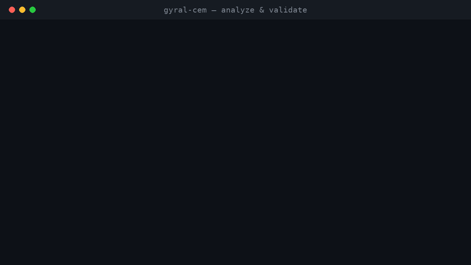
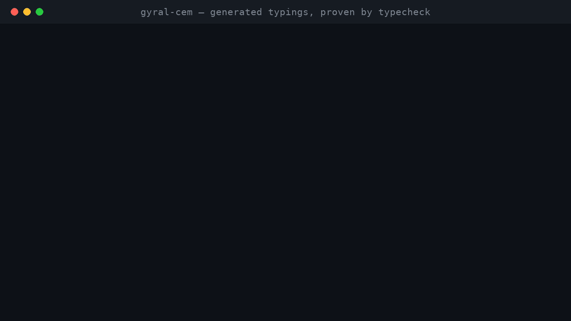
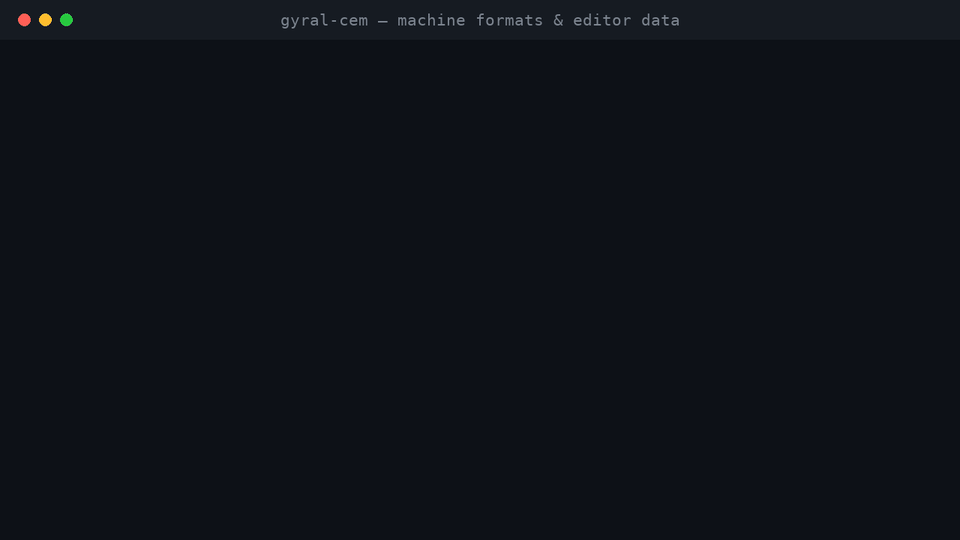

# gyral-cem

Use Gyral components from any framework. `gyral-cem` reads Gyral components and writes a
standard `custom-elements.json` (schema 2.1) plus typings for React, Vue, Svelte, and Astro, so a
Gyral component is typed and autocompleted anywhere it is used.

```sh
npx gyral-cem analyze src
```

This writes `custom-elements.json` and `dist/typings/` (`react.d.ts`, `vue.d.ts`, `svelte.d.ts`,
`astro.d.ts`, `elements.d.ts`, `html-custom-data.json`, plus one React wrapper per component and
an `index.ts` barrel). See [prd.md](./prd.md) for the full brief.

## Demo


*Analyze → typings → validate. ([MP4](docs/demo/01-analyze.mp4))*


*Generated `react.d.ts`, proven by the typecheck suite. ([MP4](docs/demo/02-typings.mp4))*


*`--check --format json`, `--version`, and editor data. ([MP4](docs/demo/03-formats.mp4))*

Every command shown runs for real; regenerate the clips with
`.venv/bin/python docs/demo/render.py` (see the script header).

## Install

```sh
npm install -D gyral-cem
```

Requires Node 20+. Vite is an optional peer, needed only for the plugin mode.

## CLI

```sh
# Analyze one or more source dirs (default typings: all frameworks)
gyral-cem analyze src --out custom-elements.json --typingsDir dist/typings

# Fewer frameworks (all: react,vue,svelte,astro,wrapper,elements,vscode)
gyral-cem analyze src --frameworks react,vue

# Use a different root or tsconfig
gyral-cem analyze src --root packages/app --tsconfig tsconfig.app.json

# Validate a manifest against the published CEM JSON schema
gyral-cem validate custom-elements.json

# Fail on warnings (dynamic part values, non-literal states, …)
gyral-cem analyze src --strict

# Regenerate on save, check without writing, machine-readable output
gyral-cem analyze src --watch
gyral-cem analyze src --check
gyral-cem analyze src --format json
gyral-cem analyze src --out - > custom-elements.json
```

Warnings print to stderr and never fail unless `--strict` is passed. Exit codes: `0` ok, `1`
validation/strict failure, `2` usage error. Run `gyral-cem <command> --help` for all flags.

Point tooling at the manifest from `package.json`:

```json
{ "customElements": "custom-elements.json" }
```

## Vite plugin

Regenerates on save, beside Gyral's own preset:

```ts
import { gyralVitePreset } from '@gyral/core';
import { gyralCemPlugin } from 'gyral-cem/vite';

export default {
  plugins: [
    gyralVitePreset({ types: true }),
    gyralCemPlugin({ dirs: ['src'], typingsDir: 'dist/typings' }),
  ],
};
```

Options: `dirs` (default `['src']`), `out` (default `custom-elements.json`), `typingsDir`
(default `dist/typings`), `frameworks` (default all), `tsconfig` (default: looked up from root).

## What gets extracted

| Manifest field | Source in Gyral | Method |
| --- | --- | --- |
| Tag name, class | `define<…>()('tag', spec)` | TypeScript AST |
| Props (attribute, type, default, required) | `prop.string/number/boolean/json/value(…)` in `spec.props`; attribute defaults to kebab-case | AST + checker for value types |
| Property-only props | `prop.value` / `attribute: false` (never reflected) | AST |
| Events | the single `gyral-output` event; `detail` is the output union `O`, the 4th `define` generic | TypeScript checker, one entry per `_tag` |
| Slots | `<slot>` / `<slot name>` in `html` templates | Template scan |
| CSS parts | `part="…"` in templates | Template scan |
| CSS custom properties | `var(--…)` in `styles` | CSS scan |
| Custom states | keys returned by `states: (s) => ({…})` | AST |
| Form association | `spec.formAssociated` | AST |

Types are printed structurally (aliases expanded), so every generated file is self-contained.

A runtime cross-check is available for free: importing components in Node makes `define` record
each spec (Gyral's `server-specs.ts`), which `diffRecordedSpecs` compares against the static
result for tags and props. Components written unusually enough to fool the AST show up as
mismatches instead of silently missing entries.

## Framework setup

**React 19** sets properties on defined custom elements. The generated `react.d.ts` augments
`react`, `react/jsx-runtime`, and global `JSX`, with per-output callbacks:

```tsx
<ProductCard sku="A12" onAddedToCart={(msg) => track(msg.sku)} />
```

The wrapper (`ProductCard.tsx`) maps each `on<Tag>` prop to a `gyral-output` listener on the
element itself (`gyral-output` is `composed: false`, so the listener cannot live higher up).
Include `dist/typings/react.d.ts` in your `tsconfig`.

Event wiring, verified against the React source (`setPropOnCustomElement`): on a custom
element, any function-valued prop starting with lowercase `on` becomes
`addEventListener(prop.slice(2))` with the remainder verbatim — so `ongyral-output` listens
for exactly `gyral-output`, and React skips DEV unknown-prop validation for custom elements.
The `on<Tag>` callbacks are wrapper API (never forwarded to the DOM), so their casing is ours
to choose.

**Vue 3.5.** The generated `vue.d.ts` fills `GlobalComponents`. You must still tell the
compiler which tags are custom elements:

```ts
vue({ template: { compilerOptions: { isCustomElement: (t) => t.includes('-') } } });
```

**Svelte 5.** `svelte.d.ts` augments `svelte/elements`; include it in your `tsconfig`.

**Astro.** `astro.d.ts` augments `astroHTML.JSX`. Verified against the published
`astro-jsx.d.ts`: `IntrinsicElements` is an interface, so generated members merge into it, and
named members take precedence over its `[name: string]` fallback for arbitrary elements.

**Storybook.** The manifest drives the web-components autodocs addon:

```ts
import { setCustomElementsManifest } from '@storybook/web-components';
import manifest from './custom-elements.json';

setCustomElementsManifest(manifest);
```

**Plain TypeScript and VS Code.** `elements.d.ts` is an `HTMLElementTagNameMap` in Gyral's own
shape (include it in your `tsconfig`); `html-custom-data.json` brings tag and attribute
completion to plain `.html` files:

```json
{ "html.customData": ["./dist/typings/html-custom-data.json"] }
```

## Troubleshooting

- **No components found.** Check `--root`/`dirs` point at the sources, and that components use
  the two-call `define<…>()('tag', spec)` form. Aliased imports (`import { define as d }`)
  work; `customElements.define` calls are ignored by design.
- **A prop or component is missed.** The analyzer follows local `props` tables, spreads, and
  JSDoc, but imported values from outside the program and fully dynamic expressions are
  reported as warnings. Run the runtime cross-check (`diffRecordedSpecs`) to confirm.
- **Warnings fail CI.** Either resolve them (prefer static `part` values and object-literal
  `states`) or keep `--strict` for local runs only.
- **Vue doesn't recognize the tags.** Types alone are not enough: set `isCustomElement` as
  shown above (the generated `vue.d.ts` header repeats the snippet).
- **React 18 hosts.** The wrappers use `forwardRef`, which works on React 18 and 19 alike.

## Node API

```ts
import { analyze, buildManifest, validateManifest } from 'gyral-cem';

const analysis = analyze({ root: process.cwd(), dirs: ['src'] });
const manifest = buildManifest(analysis.components, process.cwd());
const { valid, errors } = validateManifest(manifest);
```

## Project layout

```text
src/
  cli.ts            analyze / validate commands
  analyze.ts        program creation + extractor orchestration
  discover.ts       define<…>()('tag', spec) discovery via the TS AST
  extract/          props, outputs, templates, states, form, shadow
  manifest.ts       IR → Custom Elements Manifest 2.1
  validate.ts       Ajv check against the published CEM schema
  generators/       react, vue, svelte, astro, wrapper, elements, vscode (one file each)
  vite.ts           gyralCemPlugin + file generation shared with the CLI
  runtime-check.ts  diffRecordedSpecs: static vs Node-recorded specs
examples/           counter, product-card, form-input (+ gyral-stub)
test/               unit, snapshot, schema, typecheck, CLI, oracle tests
```

## Development

```sh
npm install          # install deps
npm test             # vitest: 86 tests
npm run typecheck    # strict tsc over src, tests, and examples
npm run build        # emit dist/
npm run demo         # analyze examples/ into ./custom-elements.json + dist/typings
```

CI runs typecheck, tests, build, and a CLI smoke run on every push.
